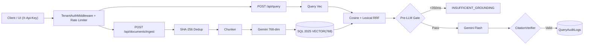

# Enterprise RAG & Hybrid Search API (.NET 10 + SQL Server 2025 `VECTOR(768)`)

[](https://github.com/dvmisani/Enterprise-RAG-Hybrid-Search-API/actions/workflows/ci-cd.yml)
[](LICENSE)

Multi-tenant RAG and hybrid search API built with **C# / .NET 10**, **SQL Server 2025 native `VECTOR(768)`**, and **Google Gemini**—featuring API-key tenant isolation, EF Core global query filters, sub-second pre-LLM refusal gating, post-synthesis citation verification, and `Testcontainers` integration tests.

- **Live Playground:** https://enterprise-rag-api-6125.azurewebsites.net *(initial request after idle sleep may take ~10–15s)*
- **Swagger UI:** https://enterprise-rag-api-6125.azurewebsites.net/swagger
- **Health Check:** https://enterprise-rag-api-6125.azurewebsites.net/health

## System Architecture



## Evaluation & Benchmark Results (16-Question CI Suite)

| Metric | Result | Notes |
| :--- | :--- | :--- |
| **In-Domain Retrieval Hit Rate** | **10 / 10 (100.0%)** | Multi-section POPIA & ZAR Treasury policy |
| **Out-of-Domain Refusal Accuracy** | **6 / 6 (100.0%)** | Refused at `PreLlmGate` (~180–340 ms) |
| **Tenant Isolation & Citations** | **100% Enforced** | `X-Api-Key` + EF Global Filter + `CitationVerifier` |

## Endpoints & Quickstart

All `/api/*` endpoints require `X-Api-Key` (demo key: `demo-public-key-2026` -> tenant `acme-fintech-za`, auto-wipes 30m): `/api/tenant/whoami`, `/api/documents` (`POST`/`GET`/`DELETE`), `/api/query` (`POST` + `GET /audit`), and `/health`.

```bash
GEMINI_API_KEY="YOUR_KEY" docker compose up --build
dotnet test --nologo --logger "console;verbosity=normal"
```

## Architectural Trade-Offs & Next Steps

- **Exact Cosine vs. Approximate Index:** Exact `VECTOR_DISTANCE('cosine', ...)` scoped by `TenantId` guarantees 100% recall without cross-tenant index leakage; SQL Server 2025 `CREATE VECTOR INDEX` can be enabled at multi-million-chunk scale.
- **Lexical Scoring & Observability:** Fuses term overlap via RRF (`k = 60`) and logs metrics to `QueryAuditLogs` (extensible to SQL Full-Text Search and OpenTelemetry / Application Insights).

