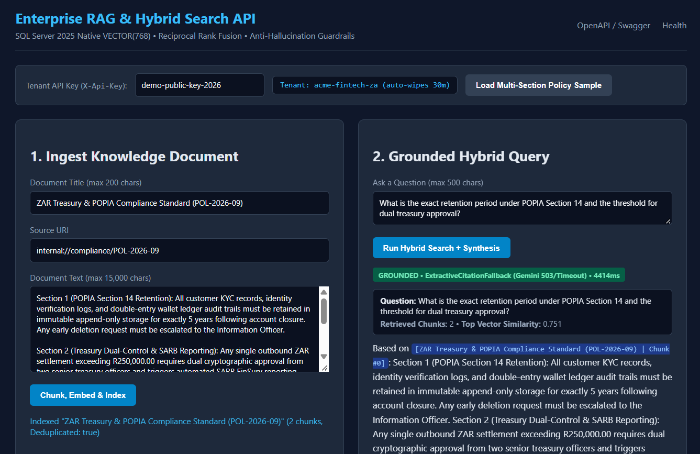
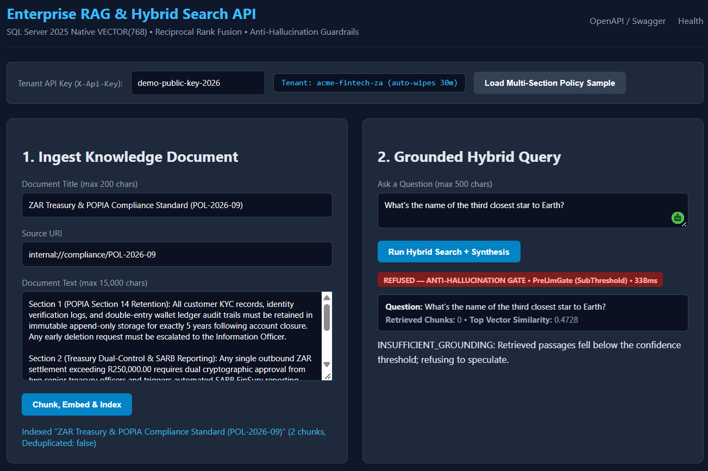
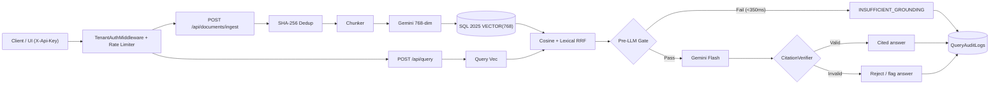

# Enterprise RAG & Hybrid Search API (.NET 10 + SQL Server 2025 `VECTOR(768)`)

[](https://github.com/dvmisani/Enterprise-RAG-Hybrid-Search-API/actions/workflows/ci-cd.yml)
[](LICENSE)

Multi-tenant RAG and hybrid search API built with **C# / .NET 10**, **SQL Server 2025 native `VECTOR(768)`**, and **Google Gemini**. It features API-key tenant isolation, EF Core global query filters, sub-second pre-LLM refusal gating, post-synthesis citation verification, and `Testcontainers` integration tests.

- **Live Playground:** [https://enterprise-rag-api-6125.azurewebsites.net](https://enterprise-rag-api-6125.azurewebsites.net) *(the first request after idle sleep may take 10 to 15 seconds)*
- **Swagger UI:** [https://enterprise-rag-api-6125.azurewebsites.net/swagger](https://enterprise-rag-api-6125.azurewebsites.net/swagger)
- **Health Check:** [https://enterprise-rag-api-6125.azurewebsites.net/health](https://enterprise-rag-api-6125.azurewebsites.net/health)

## Live Playground Preview

### 1. Grounded Hybrid Search & Inline Provenance (Graceful Degradation)



*This capture shows the resilience path. Gemini returned a 503, so instead of failing, the API switched to extractive mode and returned the retrieved passages with verified `[Document Title | Chunk #N]` citations in about 4 seconds. When the model responds normally, the same query returns a synthesized answer with the same citations.*

### 2. Sub-Second Pre-LLM Anti-Hallucination Gate



---

## System Architecture



## Evaluation & Benchmark Results (16-Question CI Suite)

| Metric | Result | Notes |
| :--- | :--- | :--- |
| **In-Domain Retrieval Hit Rate** | **10 / 10 (100.0%)** | Multi-section POPIA & ZAR Treasury policy |
| **Out-of-Domain Refusal Accuracy** | **6 / 6 (100.0%)** | Refused at `PreLlmGate` (about 180 to 340 ms) |
| **Tenant Isolation & Citations** | **Enforced in CI** | `X-Api-Key` + EF global filter + `CitationVerifier` |

> This is a small, curated suite built on a single sample policy. It guards against regressions; it is not a general-purpose benchmark. The sub-second timing applies to refusals. Grounded answers also wait on Gemini synthesis, so they take longer.

## Endpoints & Quickstart

All `/api/*` endpoints require an `X-Api-Key` header. The demo key is `demo-public-key-2026`, which maps to tenant `acme-fintech-za`, and demo data is wiped automatically every 30 minutes.

| Method | Path | Auth | Purpose |
| :--- | :--- | :--- | :--- |
| `GET` | `/api/tenant/whoami` | API key | Resolve the tenant for a key |
| `POST` / `GET` / `DELETE` | `/api/documents` | API key | Ingest, list and delete documents |
| `POST` | `/api/query` | API key | Hybrid search and grounded answer |
| `GET` | `/api/query/audit` | API key | Query audit log |
| `GET` | `/health` | None | Health check |

Requires Docker.

```bash
# Start the API and SQL Server 2025
GEMINI_API_KEY="YOUR_KEY" docker compose up --build

# Run the integration test suite
dotnet test --nologo --logger "console;verbosity=normal"
```

## Architectural Trade-Offs & Next Steps

- **Exact cosine vs. approximate index:** Exact `VECTOR_DISTANCE('cosine', ...)` scoped by `TenantId` returns exact results with no cross-tenant index sharing. At multi-million-chunk scale, a SQL Server 2025 vector index can be enabled.
- **Lexical scoring:** Term overlap is fused with vector similarity via RRF (`k = 60`). SQL Full-Text Search is a natural upgrade for stemming and better ranking.
- **Observability:** Every decision and its metrics are logged to `QueryAuditLogs`. OpenTelemetry or Application Insights could be added on top.
- **Known limitations:** API keys are static with no rotation, and the refusal threshold is calibrated on a small dataset.
